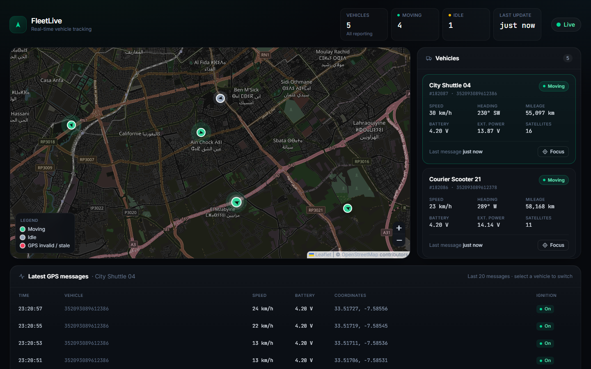

# FleetLive

A live dashboard for tracking vehicles by GPS. Trackers post telemetry to an HTTP API, and a queue worker stores it. The dashboard shows each vehicle's position, status and latest messages on an OpenStreetMap map, with markers that glide smoothly between updates.



**Stack:** Laravel 13 · Inertia.js + React 19 · Tailwind CSS 4 · MySQL (InnoDB) · Redis (queue and cache) · Leaflet + OpenStreetMap

There is no authentication: it is a public demo dashboard. Live updates use HTTP polling; there are no WebSockets.

## Features

- **Ingest API.** `POST /api/gps/ingest` accepts one telemetry object or a batch of up to 500. It validates the input, queues it and answers `202 Accepted` right away.
- **Queued processing.** One job writes the event history and the latest position, then refreshes the Redis cache. Duplicate and out-of-order messages are handled safely.
- **Live map.** Custom markers point in the direction of travel and change colour with status: green = moving, gray = idle, red = GPS invalid or stale. Each update glides over about 1.5 s.
- **Vehicle list.** Shows status badges, speed, heading, battery, external power, mileage and "12s ago" timestamps. A Focus button flies the map to the vehicle.
- **Activity feed.** The last 20 GPS messages of the selected vehicle. New messages slide in as they arrive.
- **Connection status.** A pulsing Live indicator, a Reconnecting… state while polls fail, and a Reconnect button after repeated failures.
- **Simulator.** `php artisan gps:simulate` drives 5 demo vehicles around Casablanca and sends their data through the real API.

## Quick start

There are two ways to run it. Both use the same code; only `.env` changes.

### Option A: instant mode (no MySQL, no Redis)

The fastest way to see it working. Everything runs on SQLite and files.

```bash
composer install
npm install
cp .env.example .env
php artisan key:generate
```

Edit `.env`:

```dotenv
DB_CONNECTION=sqlite
# comment out or delete the other DB_* lines
CACHE_STORE=file
QUEUE_CONNECTION=sync
```

Then:

```bash
touch database/database.sqlite        # PowerShell: New-Item database/database.sqlite
php artisan migrate --seed
npm run dev                           # terminal 1
php artisan serve                     # terminal 2
php artisan gps:simulate              # terminal 3
```

Open http://127.0.0.1:8000. No queue worker is needed in this mode. [docs/running-without-redis.md](docs/running-without-redis.md) explains what this mode changes and lists the other alternatives.

### Option B: full stack (MySQL + Redis)

This is the setup the project is designed for.

```bash
composer install
npm install
cp .env.example .env                  # already configured for MySQL and Redis
php artisan key:generate
# create the database first: CREATE DATABASE fleetlive;
php artisan migrate --seed
```

Run each of these in its own terminal:

```bash
npm run dev
php artisan serve
php artisan queue:work redis
php artisan gps:simulate
```

Installing MySQL and Redis on Windows, macOS and Linux, plus troubleshooting, is covered in [docs/setup.md](docs/setup.md).

## Documentation

| Document | Contents |
| --- | --- |
| [docs/setup.md](docs/setup.md) | Requirements, installing MySQL/Redis per OS, every `.env` value, running, the simulator, tests, troubleshooting |
| [docs/running-without-redis.md](docs/running-without-redis.md) | What Redis does here, alternatives (file, database, sync, SQLite) and their trade-offs |
| [docs/architecture.md](docs/architecture.md) | Data flow, database design, queue job, polling cursor, caching, concurrency, frontend, scaling |
| [docs/api.md](docs/api.md) | Every endpoint with request/response examples, the payload field mapping, validation and rate limits |

## Project structure

```
app/
├── Console/Commands/SimulateGpsCommand.php   gps:simulate
├── Http/
│   ├── Controllers/
│   │   ├── GpsIngestController.php           POST /api/gps/ingest
│   │   ├── VehiclePositionController.php     GET /api/gps/vehicles, /vehicles/updates
│   │   └── GpsEventController.php            GET /api/gps/vehicles/{id}/events
│   └── Requests/GpsIngestRequest.php         validation (single or batch)
├── Jobs/StoreGpsEventJob.php                 queued persistence
├── Models/                                   Vehicle, VehicleCurrentPosition, GpsEvent
├── Services/
│   ├── GpsPayloadNormalizer.php              dotted keys → structured array
│   └── VehiclePositionCache.php              Redis read/write with MySQL fallback
└── Support/SimulatedVehicle.php              fake tracker movement

database/migrations/                          vehicles, vehicle_current_positions, gps_events, failed_jobs
database/seeders/FleetSeeder.php              5 demo vehicles + history

resources/js/
├── Pages/Dashboard.jsx                       the single page
├── components/                               Header, LiveMap, VehicleList, ActivityFeed, StatusBadge, Icons
├── hooks/                                    useVehiclePolling, useVehicleEvents, useNow, useAnimatedNumber
└── lib/                                      animateMarker, vehicleStatus, format

tests/Feature/                                GpsIngestTest, VehicleApiTest
```

## Tests

```bash
php artisan test
```

The tests run on in-memory SQLite with an array cache and a sync queue, so they need neither MySQL nor Redis. They cover ingestion (single and batch), validation errors, job persistence, deduplication, invalid-GPS handling, out-of-order messages, the polling endpoint, the Redis fallback and the events feed.
